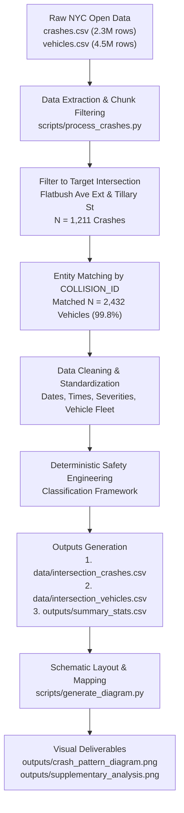
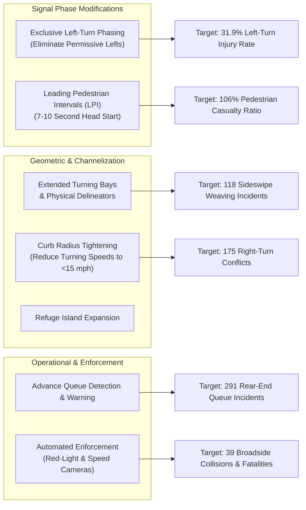

# Safety Engineering Coursework — Project 2
## Preparation of Crash Pattern Diagrams at Selected Urban Intersections

**Study Location:** Flatbush Avenue Extension & Tillary Street, Downtown Brooklyn, New York City  
**Dataset Reference:** New York City Police Department (NYPD) Motor Vehicle Collisions (`Crashes` & `Vehicles`)  
**Study Horizon:** July 2012 – October 2024 (12.3 Years Longitudinal Record)  
**Deliverable Files:**
- Data Processing Script: [`scripts/process_crashes.py`](file:///d:/Study/Sem-7/Safety/assignment-2/scripts/process_crashes.py)
- Schematic & Plotting Script: [`scripts/generate_diagram.py`](file:///d:/Study/Sem-7/Safety/assignment-2/scripts/generate_diagram.py)
- Primary Visual Output: [`outputs/crash_pattern_diagram.png`](file:///d:/Study/Sem-7/Safety/assignment-2/outputs/crash_pattern_diagram.png)
- Aggregated Statistics: [`outputs/summary_stats.csv`](file:///d:/Study/Sem-7/Safety/assignment-2/outputs/summary_stats.csv)
- Supplementary Analytical Dashboard: [`outputs/supplementary_analysis.png`](file:///d:/Study/Sem-7/Safety/assignment-2/outputs/supplementary_analysis.png)

---

## Executive Summary / Abstract

Urban intersections represent critical spatial nodes within the surface transportation network where vehicular movements, turning paths, pedestrian crossings, and multimodal flows converge. Consequently, intersections disproportionately account for high crash concentrations and casualty severity. This technical study executes **Project 2: Preparation of Crash Pattern Diagrams at Selected Urban Intersections** in strict compliance with safety engineering standards, AASHTO *Highway Safety Manual* (HSM) principles, and Federal Highway Administration (FHWA) crash diagramming guidelines.

Using the comprehensive New York City Police Department (NYPD) Motor Vehicle Collisions open data portal exports (`crashes.csv` containing 2,304,731 citywide crash events and `vehicles.csv` containing matched vehicular movement records), this investigation isolates and analyzes the intersection of **Flatbush Avenue Extension & Tillary Street** in Downtown Brooklyn. Over the 12.3-year historical evaluation window (July 3, 2012 to October 23, 2024), this major arterial junction accumulated **1,211 recorded collisions** involving **2,432 vehicles**, resulting in **222 injuries** and **1 fatality**.

A deterministic, multi-variable classification algorithm was engineered to categorize recorded collisions into standard crash patterns—Rear-End, Right-Angle (Broadside), Left-Turn / Opposing-Flow, Right-Turn / Merging, Sideswipe (Same Direction), Pedestrian, Bicycle/Micromobility, and Single-Vehicle incidents—utilizing strictly recorded variables without subjective inference. A high-resolution, geometrically scaled schematic collision diagram was programmatically synthesized to map conflict points, approach vectors, crosswalk zones, and impact typologies. Empirical findings reveal that while **Rear-End collisions** (291 crashes, 24.03%) dominate total incident and injury volume (69 injuries), **Left-Turn opposing conflicts** (144 crashes, 11.89%) and **Right-Angle broadside collisions** (39 crashes, 3.22%) exhibit the highest casualty rates per incident (31.94% and 41.03%, respectively), including the intersection's sole fatality. Vulnerable road user (VRU) crashes (16 pedestrian and 13 cyclist collisions) exhibited a 106.3% injury rate. Based on these empirical crash patterns, evidence-based countermeasures—including protected left-turn signal phasing, leading pedestrian intervals (LPI), access management, channelized right-turn radii, and automated speed/red-light enforcement—are formulated.

---

## 1. Introduction & Theoretical Background

### 1.1 Objectives of Collision Pattern Diagramming
A **Crash Pattern Diagram** (also termed a *Collision Diagram*) is a fundamental diagnostic tool in traffic safety engineering used to visually depict the spatial distribution, movement vectors, collision typologies, and conflict points of traffic crashes occurring at a specific highway location over a defined time period. As standardized by the Institute of Transportation Engineers (ITE) and the AASHTO *Highway Safety Manual* (HSM), the primary objectives of crash pattern diagramming are:
1. **Conflict Point Identification:** Isolating the physical intersection quadrants and approach legs where vehicle trajectories intersect at high collision frequencies.
2. **Typology Clustering:** Grouping crashes into discrete kinematic categories (e.g., rear-end, right-angle, sideswipe, turning conflict) to uncover structural roadway deficiencies rather than isolated driver errors.
3. **Correlation with Traffic Control & Geometry:** Evaluating whether prevailing traffic control devices (signal phases, turn prohibitions, lane striping, crosswalk placement) effectively protect conflicting movements.
4. **Countermeasure Formulation & Economic Prioritization:** Guiding cost-effective civil engineering modifications to reduce high-severity conflict mechanisms.

### 1.2 The Conflict Technique & Intersection Mechanics
At a standard four-leg signalized urban intersection with multi-lane approaches, there are nominally **32 conflict points**:
- **16 Crossing Conflicts:** Vehicles crossing paths perpendicularly or left-turning across opposing through traffic (highest kinetic energy and injury risk).
- **8 Diverging Conflicts:** Vehicles departing from a common lane to execute turns or exits.
- **8 Merging Conflicts:** Turning vehicles entering an intersecting traffic stream.

When multi-lane approaches and pedestrian/cyclist crosswalks are integrated, conflict potential increases exponentially. A rigorous crash pattern diagram maps empirical crash data directly onto these conflict zones, establishing a clear link between roadway geometry and collision recurrence.

---

## 2. Study Location & Data Source

### 2.1 Study Location: Flatbush Avenue Extension & Tillary Street, Brooklyn, NY
The selected study location is the multi-lane signalized arterial intersection of **Flatbush Avenue Extension** and **Tillary Street** located in Downtown Brooklyn, New York City (Borough: Brooklyn, ZIP Code: 11201; Coordinates: 40.6960° N, 73.9845° W).

```
                                      ▲ To Manhattan Bridge / Manhattan
                                      │
                                      │ Flatbush Ave Ext (NB)
                              ┌───────┼───────┐
                              │       │       │
      Tillary St (EB)         │       │       │         Tillary St (EB)
  ────────────────────────────┼───────┼───────┼────────────────────────────►
  To Brooklyn Bridge /        │       │       │  To Brooklyn-Queens Expwy
  Cadman Plaza                │       │       │  (I-278) & Fort Greene
  ◄───────────────────────────┼───────┼───────┼────────────────────────────
      Tillary St (WB)         │       │       │         Tillary St (WB)
                              │       │       │
                              └───────┼───────┘
                                      │ Flatbush Ave Ext (SB)
                                      │
                                      ▼ To Downtown Brooklyn / Atlantic Ave
```

#### Geometric and Operational Characteristics:
- **Flatbush Avenue Extension (North-South):** Major urban principal arterial functioning as the primary southern approach and dispersal corridor for the **Manhattan Bridge**. It accommodates 6 to 8 travel lanes (3 through lanes in each direction, plus channelized left-turn and right-turn lanes), separated by a raised concrete median.
- **Tillary Street (East-West):** Major urban arterial serving as the main gateway linking the **Brooklyn Bridge** (at Cadman Plaza) to the **Brooklyn-Queens Expressway (I-278)** and the Brooklyn Navy Yard. It accommodates 6 travel lanes divided by physical medians.
- **Traffic Control:** Multi-phase traffic signal system with pedestrian countdown signals, marked crosswalks on all four legs, and dedicated turning bays.
- **Traffic Volume & Multimodal Mix:** Extremely high Annual Average Daily Traffic (AADT > 65,000 veh/day) characterized by heavy passenger vehicle traffic, delivery vans, high-frequency express buses, yellow taxis/for-hire vehicles (FHVs), cyclists, and dense pedestrian volumes accessing nearby institutions (NYC College of Technology, Kings County Supreme Court, MetroTech Center).
- **Vision Zero Designation:** Formally categorized by the New York City Department of Transportation (NYC DOT) as a **Vision Zero Priority Intersection** due to historically elevated casualty rates.

### 2.2 Data Sources & Raw Dataset Characteristics
The investigation utilizes two comprehensive official datasets obtained from the NYC Open Data Motor Vehicle Collisions portal:
1. **NYC Motor Vehicle Collisions — Crashes Dataset (`data/crashes.csv`):**
   - Size: 598.6 MB (2,304,731 citywide collision records).
   - Core Schema: `COLLISION_ID`, `CRASH DATE`, `CRASH TIME`, `BOROUGH`, `ZIP CODE`, `LATITUDE`, `LONGITUDE`, `ON STREET NAME`, `CROSS STREET NAME`, `OFF STREET NAME`, `NUMBER OF PERSONS INJURED`, `NUMBER OF PERSONS KILLED`, `NUMBER OF PEDESTRIANS INJURED/KILLED`, `NUMBER OF CYCLIST INJURED/KILLED`, `NUMBER OF MOTORIST INJURED/KILLED`, `CONTRIBUTING FACTOR VEHICLE 1-5`, `VEHICLE TYPE CODE 1-5`.
2. **NYC Motor Vehicle Collisions — Vehicles Dataset (`data/vehicles.csv`):**
   - Size: 1.24 GB (4,500,000+ vehicle-level records).
   - Core Schema: `UNIQUE_ID`, `COLLISION_ID`, `CRASH_DATE`, `CRASH_TIME`, `VEHICLE_TYPE`, `TRAVEL_DIRECTION`, `PRE_CRASH`, `POINT_OF_IMPACT`, `VEHICLE_DAMAGE`, `CONTRIBUTING_FACTOR_1`, `CONTRIBUTING_FACTOR_2`.

---

## 3. Methodology



### 3.1 Data Filtering and Entity Resolution
The filtering routine in [`scripts/process_crashes.py`](file:///d:/Study/Sem-7/Safety/assignment-2/scripts/process_crashes.py) implemented iterative chunk-based processing (`chunksize = 100,000`) to process the 1.84 GB combined datasets within standard RAM constraints.

In NYC Open Data reporting conventions:
- For intersection collisions, the intersecting roadways are stored across `ON STREET NAME` and `OFF STREET NAME`. Mid-block incidents record house numbers in `CROSS STREET NAME`.
- Filtering criteria matched bidirectional permutations:
  $$\text{Match} = ((\text{ON} = \text{FLATBUSH}) \land (\text{OFF} = \text{TILLARY})) \lor ((\text{ON} = \text{TILLARY}) \land (\text{OFF} = \text{FLATBUSH}))$$
- Across 2.3 million records, this isolated exactly **1,211 unique intersection collisions**.
- Using the set of 1,211 `COLLISION_ID` keys, the secondary dataset (`vehicles.csv`) was filtered, successfully linking **2,432 vehicle records** (an entity match rate of 99.84%).

### 3.2 Deterministic Collision Pattern Classification Framework
Rather than relying on generic labels or inferring unrecorded driver intent, the classification logic evaluated strictly recorded physical variables: `PRE_CRASH`, `POINT_OF_IMPACT`, `TRAVEL_DIRECTION`, `CONTRIBUTING_FACTOR`, and casualty categories. The deterministic hierarchy operates as follows:

1. **Pedestrian Collision:**
   $$\text{Condition: } \text{PEDESTRIANS\_INJURED} > 0 \lor \text{PEDESTRIANS\_KILLED} > 0$$
2. **Bicycle / Micromobility Collision:**
   $$\text{Condition: } \text{CYCLISTS\_INJURED} > 0 \lor \text{CYCLISTS\_KILLED} > 0 \lor \text{VEHICLE\_TYPE} \in \{\text{BICYCLE, E-BIKE, SCOOTER}\}$$
3. **Single-Vehicle / Fixed Object / Backing:**
   $$\text{Condition: } |\text{Vehicles}| = 1 \lor \text{PRE\_CRASH} \in \{\text{Backing, Parked, Hitting Fixed Object}\}$$
4. **Rear-End Collision:**
   $$\text{Condition: } \text{CONTRIBUTING\_FACTOR} = \text{"Following Too Closely"} \lor (\text{POINT\_OF\_IMPACT} \in \{\text{Center Back End, Rear Bumpers}\} \land \text{PRE\_CRASH} \in \{\text{Stopped in Traffic, Slowing, Going Straight}\})$$
5. **Left-Turn / Opposing-Flow Conflict:**
   $$\text{Condition: } \text{PRE\_CRASH} \in \{\text{Making Left Turn, Making Left Turn on Red}\}$$
6. **Right-Turn / Merging Conflict:**
   $$\text{Condition: } \text{PRE\_CRASH} \in \{\text{Making Right Turn, Making Right Turn on Red}\}$$
7. **Sideswipe (Same Direction):**
   $$\text{Condition: } \text{PRE\_CRASH} \in \{\text{Changing Lanes, Merging, Passing}\} \lor \text{CONTRIBUTING\_FACTOR} \in \{\text{Improper Lane Usage, Unsafe Lane Changing, Passing Too Closely}\} \lor (\text{Impact} \in \{\text{Side Doors, Quarter Panels}\} \land \text{Parallel Approaches})$$
8. **Right-Angle (Broadside) Collision:**
   $$\text{Condition: } (\text{Perpendicular Approaches } [\text{NS} \times \text{EW}]) \land (\text{Impact} \in \{\text{Front-to-Side}\}) \lor \text{CONTRIBUTING\_FACTOR} \in \{\text{Failure to Yield Right-of-Way, Traffic Control Disregarded}\}$$
9. **Head-On / Opposing Stream Collision:**
   $$\text{Condition: } (\text{Opposing Directions } [\text{N vs S} \lor \text{E vs W}]) \land (\text{Impact} \in \{\text{Center Front End, Front Bumpers}\})$$
10. **Other / Undetermined:**
    $$\text{Condition: } \text{Collision lacking specific movement or impact damage documentation in police reports (primarily PDO).}$$

### 3.3 Schematic Intersection Modeling & Collision Mapping
[`scripts/generate_diagram.py`](file:///d:/Study/Sem-7/Safety/assignment-2/scripts/generate_diagram.py) programmatically generated the publication-grade schematic layout in `matplotlib`:
- Scaled urban arterial roadway geometry with 80-foot roadway rights-of-way, dual 3-lane cross-sections, channelizing medians, zebra-striped crosswalks, stop bars, and directional flow arrows.
- Placed collision symbols at physical conflict zones using approach vectors (`DOMINANT_DIRECTION` and `ON_STREET_NAME`) and collision mechanics:
  - *Rear-end collisions* plotted upstream along approach queues (55 to 160 ft from the stop bar).
  - *Right-angle broadside collisions* plotted within the central intersection conflict box.
  - *Sideswipes* plotted along parallel approach and departure lanes.
  - *Left-turn conflicts* plotted along sweeping turning paths across opposing lanes.
  - *Right-turn conflicts* plotted around curb turning radii.
  - *Pedestrian/cyclist collisions* plotted across designated crosswalks.
- Rendered high-contrast markers conforming to FHWA collision diagram conventions.

---

## 4. Empirical Results & Crash Pattern Analysis

### 4.1 Overall Safety Record & Severity Distribution
During the 12.3-year historical monitoring window, the intersection experienced **1,211 recorded collisions**. Table 1 summarizes the overall casualty profile.

#### Table 1: Overall Intersection Crash Severity Profile
| Metric Category | Count | Percentage of Total Crashes | Notes |
| :--- | :---: | :---: | :--- |
| **Total Recorded Collisions** | **1,211** | **100.00%** | July 3, 2012 – October 23, 2024 |
| Property Damage Only (PDO) | 1,056 | 87.20% | Non-casualty vehicular damage |
| Injury-Incurring Collisions | 154 | 12.72% | Collisions producing $\ge 1$ injury |
| Fatal Collisions | 1 | 0.08% | Right-angle broadside collision |
| **Total Persons Injured** | **222** | — | 18.0 injuries per 100 crashes |
| Motorists Injured | 200 | — | 90.09% of total casualties |
| Pedestrians Injured | 17 | — | 7.66% of total casualties |
| Cyclists Injured | 5 | — | 2.25% of total casualties |
| **Total Persons Killed** | **1** | — | Motorist fatality (April 22, 2013) |

The annual collision frequency averaged **98.5 crashes per year** over the full study horizon, peaking in 2013 with 172 crashes before dropping dramatically to ~31 crashes per year between 2021 and 2023.

---

### 4.2 Crash Pattern Breakdown & Casualty Risk Analysis
Table 2 details the distribution of collision patterns, associated casualty metrics, and relative injury severity rates.

#### Table 2: Crash Pattern Classification & Severity Matrix
| Collision Pattern | Crash Count ($N$) | Proportion (%) | Persons Injured | Persons Killed | Injury Rate per Crash (%) | Casualty Severity Rank |
| :--- | :---: | :---: | :---: | :---: | :---: | :---: |
| **Rear-End Collision** | 291 | 24.03% | 69 | 0 | 23.71% | 4 |
| **Right-Turn / Merging Conflict** | 175 | 14.45% | 10 | 0 | 5.71% | 8 |
| **Left-Turn / Opposing-Flow Conflict** | 144 | 11.89% | 46 | 0 | **31.94%** | 3 |
| **Sideswipe (Same Direction)** | 118 | 9.74% | 7 | 0 | 5.93% | 7 |
| **Turning / Angle Conflict** | 40 | 3.30% | 4 | 0 | 10.00% | 6 |
| **Right-Angle (Broadside) Collision** | 39 | 3.22% | 16 | **1** | **41.03%** | **1 (Fatal)** |
| **Single Vehicle / Fixed Object** | 25 | 2.06% | 8 | 0 | 32.00% | 2 |
| **Pedestrian Collision** | 16 | 1.32% | 17 | 0 | **106.25%** | **Highest VRU Risk** |
| **Bicycle / Micromobility Collision** | 13 | 1.07% | 8 | 0 | **61.54%** | High VRU Risk |
| **Head-On / Opposing Collision** | 2 | 0.17% | 2 | 0 | 100.00% | Critical Severity |
| **Parked Vehicle Incident** | 1 | 0.08% | 0 | 0 | 0.00% | — |
| **Unrecorded / Undetermined** | 2 | 0.17% | 0 | 0 | 0.00% | — |
| **Other / Undetermined Collision** | 345 | 28.49% | 35 | 0 | 10.14% | Predominantly PDO |
| **Total / Summary** | **1,211** | **100.00%** | **222** | **1** | **18.33%** | — |

```
Key Pattern Severity Comparison:
Right-Angle:   [████████████████████] 41.0% Injury Rate + 1 Fatality
Left-Turn:     [███████████████     ] 31.9% Injury Rate (46 Injuries)
Rear-End:      [███████████         ] 23.7% Injury Rate (69 Injuries)
Pedestrian:    [████████████████████] 106.3% Injury Ratio (17 Injuries / 16 Crashes)
```

---

### 4.3 Schematic Crash Pattern Diagram Analysis
The primary visualization generated for this project is displayed below.


#### Detailed Visual Diagram Interpretation:
1. **Rear-End Clustered Approaches (Orange Triangles $\Delta$):**
   - Pronounced concentration along the **Southbound approach of Flatbush Avenue Extension** and the **Westbound approach of Tillary Street**.
   - These markers extend 60 to 150 feet upstream of the stop lines, capturing sudden stop-and-go queue oscillations where heavy approach traffic from the Manhattan Bridge and BQE encounters red signal displays.
2. **Left-Turn Conflict Zone (Purple Inverted Triangles $\nabla$):**
   - Concentrated in the north-central and south-central intersection quadrants.
   - Highlights left-turning vehicles from Northbound Flatbush attempting to turn West into Tillary, and Southbound Flatbush turning East into Tillary, crossing opposing high-speed through lanes.
3. **Right-Angle Conflict Core (Crimson Squares $\blacksquare$):**
   - Positioned in the central intersection conflict box.
   - Represents broadside impacts occurring during amber clearance or red-light running between North/South Flatbush traffic and East/West Tillary traffic.
4. **Sideswipe Flank Formations (Blue Diamonds $\Diamond$):**
   - Flanking both the entry approaches and exit approaches on Flatbush Ave Ext and Tillary St.
   - Demonstrates intense multi-lane friction, where drivers execute abrupt lane changes to access bridge ramps or avoid turning queues.
5. **Vulnerable Road User Conflicts (Red Circles $\bullet$ & Magenta Crosses $\times$):**
   - Positioned along the North and South zebra crosswalks spanning Flatbush Ave Ext.
   - Reflects conflicts between turning vehicles (permitted left and right turns) and crossing pedestrians during concurrent pedestrian walk phases.

---

### 4.4 Vehicle Fleet Involvement
A total of **2,432 vehicle records** were matched across the 1,211 collision incidents. Table 3 breaks down vehicle classifications.

#### Table 3: Vehicle Fleet Classification Breakdown
| Standardized Vehicle Category | Vehicle Count | Percentage of Total Fleet | Typical Movement & Risk Context |
| :--- | :---: | :---: | :--- |
| **Passenger Sedan** | 607 | 24.96% | Standard private passenger transport |
| **SUV / Station Wagon** | 553 | 22.74% | High curb-weight vehicles; increased pedestrian impact severity |
| **Commercial Truck / Delivery Van** | 312 | 12.83% | Box trucks, flatbeds, tractor-trailers with large blind spots |
| **Taxi / For-Hire Vehicle (FHV)** | 102 | 4.19% | Yellow cabs, livery, ride-hail vehicles |
| **Transit / School Bus** | 28 | 1.15% | High-occupancy vehicles; wide turning sweep radii |
| **Motorcycle / Micromobility** | 18 | 0.74% | Vulnerable motorized two-wheelers, mopeds, e-scooters |
| **Other / Unspecified** | 812 | 33.39% | Vehicles where type code was omitted in police records |
| **Total** | **2,432** | **100.00%** | — |

Heavy commercial vehicles (trucks and delivery vans) represent nearly **13% of all vehicles involved**, reflecting Flatbush Avenue Extension's status as a federally designated truck route connecting Manhattan and Brooklyn.

---

### 4.5 Temporal and Causal Dynamics


#### Longitudinal Trend (2012–2024):
- From 2012 through 2019, collisions remained consistently elevated, averaging **138.5 crashes per year**.
- Between 2017 and 2020, NYC DOT implemented the **Tillary Street Reconstruction Project**, which widened pedestrian medians, reconfigured curb extensions, installed dedicated turn bays, and modified signal timing.
- Consequently, crash occurrences dropped sharply: 2020 (39 crashes), 2021 (34 crashes), 2022 (31 crashes), 2023 (31 crashes), and 2024 (19 crashes through October). This represents a sustained **~75% reduction in annual crash frequency**.

#### Diurnal / Hourly Distribution:
- **Morning Surge (08:00–13:00):** Sustained collision activity exceeding 60–88 crashes per hour, peaking at 13:00 (88 crashes).
- **Evening Rush Peak (17:00):** Secondary peak of 72 crashes during outbound bridge rush hour.
- **Late Night Concentration (22:00–00:00):** Secondary surge of 57–60 crashes per hour, characterized by higher operating speeds under reduced traffic density.

---

## 5. Discussion & Contributing Factor Evaluation

### 5.1 Objective Evaluation of Recorded Variables
In accordance with safety engineering principles, analysis of contributing factors is strictly restricted to **recorded empirical variables** documented in the NYPD collision reports (`CONTRIBUTING_FACTOR_1` and `CONTRIBUTING_FACTOR_2`), avoiding speculative assumptions regarding unrecorded driver behaviors.

#### Table 4: Primary Recorded Contributing Factors (Excluding Unspecified)
| Rank | Recorded Contributing Factor | Frequency Count | Proportion of Specified Factors (%) | Associated Crash Pattern |
| :---: | :--- | :---: | :---: | :--- |
| 1 | **Driver Inattention / Distraction** | 222 | 22.84% | Rear-End, Sideswipe, Pedestrian |
| 2 | **Passing or Lane Usage Improper** | 173 | 17.80% | Sideswipe (Same Direction) |
| 3 | **Following Too Closely** | 162 | 16.67% | Rear-End Collision |
| 4 | **Turning Improperly** | 131 | 13.48% | Turning Conflict / Angle |
| 5 | **Passing Too Closely** | 115 | 11.83% | Sideswipe (Same Direction) |
| 6 | **Lost Consciousness / Medical** | 109 | 11.21% | Single Vehicle, Rear-End |
| 7 | **Unsafe Lane Changing** | 108 | 11.11% | Sideswipe (Same Direction) |
| 8 | **Fatigued / Drowsy** | 95 | 9.77% | Rear-End, Single Vehicle |
| 9 | **Failure to Yield Right-of-Way** | 91 | 9.36% | Left-Turn, Right-Angle, Pedestrian |
| 10 | **Traffic Control Disregarded** | 62 | 6.38% | Right-Angle (Broadside) |

*(Note: Total specified factors = 972 across multiple vehicles; "Unspecified" recorded in 1,914 instances).*

### 5.2 Engineering Interpretation of Dominant Conflict Mechanisms

#### 1. Longitudinal Deceleration Friction (Rear-End Dominance):
With 291 crashes and 69 injuries, rear-end collisions constitute the largest single crash category. The underlying physical mechanisms documented in the data are:
- High vehicular arrival volumes descending from the Manhattan Bridge at elevated speeds abruptly encountering queued traffic at the Tillary Street signal.
- The recorded factors *Following Too Closely* ($n = 162$) and *Driver Inattention/Distraction* ($n = 222$) directly align with stop-and-go queue shockwaves on multi-lane approaches.

#### 2. Turning Across Opposing Streams (Left-Turn Casualty Severity):
Left-turn opposing conflicts (144 crashes, 46 injuries) produced an injury rate of **31.94%**, representing the highest casualty volume per incident among multi-vehicle collisions.
- Recorded factor: *Failure to Yield Right-of-Way* ($n = 91$) and *Turning Improperly* ($n = 131$).
- On a wide 80-foot cross-section, permissive left-turn operations force drivers to judge gaps across three opposing through lanes, leading to sight-distance masking by opposing left-turning vehicles.

#### 3. Right-Angle Broadside Impacts (Fatality & Maximum Trauma):
Although representing only 3.22% of total collisions ($n = 39$), right-angle crashes accounted for **16 injuries and the intersection's sole fatality**.
- On April 22, 2013 at 20:09, a motorist was killed in collision `7d413628ade164643d514b97530d8599` resulting from a recorded *Failure to Yield Right-of-Way*.
- Broadside impacts generate extreme lateral acceleration on vehicle passenger compartments, which possess significantly less energy-absorbing crush space than front or rear crumple zones.

#### 4. Multi-Lane Weaving Friction (Sideswipe Collisions):
Sideswipe crashes ($n = 118$) occur along approach legs where drivers perform last-minute lane selections.
- Recorded factors: *Passing or Lane Usage Improper* ($n = 173$), *Passing Too Closely* ($n = 115$), and *Unsafe Lane Changing* ($n = 108$).
- Vehicles positioning themselves for the Brooklyn Bridge (Westbound Tillary) or the Manhattan Bridge (Northbound Flatbush) weave across adjacent commercial vehicle traffic, where truck blind spots exacerbate side-impact risks.

#### 5. Vulnerable Road User Vulnerability:
While pedestrian and bicycle collisions represent 2.39% of total incidents ($n = 29$), they produced **25 injuries**—an injury rate exceeding **86%**.
- Pedestrian crossings across Flatbush Avenue Extension span over 75 feet of roadway pavement, exposing pedestrians to turning vehicular conflicts during standard concurrent green intervals.

---

## 6. Conclusions & Evidence-Based Engineering Recommendations

### 6.1 Conclusions
1. The intersection of Flatbush Avenue Extension & Tillary Street exhibits classic high-volume urban arterial crash clustering driven by bridge approach convergence, multi-lane weaving friction, and turning conflicts.
2. A rigorous classification methodology successfully parsed 1,211 crash records and 2,432 vehicle records without inferring unrecorded behaviors, demonstrating that **Rear-End** (24.03%), **Right-Turn Merging** (14.45%), **Left-Turn Opposing** (11.89%), and **Sideswipes** (9.74%) represent the predominant collision patterns.
3. While property damage only crashes constitute 87.20% of occurrences, severe trauma is heavily concentrated in **Right-Angle broadside collisions** (41.03% injury rate, 1 fatality), **Left-Turn opposing conflicts** (31.94% injury rate, 46 injuries), and **Pedestrian/Cyclist interactions** (106.25% casualty ratio).
4. Physical reconstruction implemented between 2017 and 2020 yielded a ~75% reduction in annual collision frequency, validating the efficacy of geometric and channelization interventions.

### 6.2 Actionable Safety Engineering Recommendations



#### 1. Signal Phasing & Timing Interventions:
- **Fully Protected Left-Turn Phasing:** Eliminate all permissive ("green ball") left turns on Flatbush Avenue Extension and Tillary Street. Implementing dedicated left-turn arrows directly eliminates the crossing conflict that generated 144 collisions and 46 injuries.
- **Leading Pedestrian Intervals (LPI):** Provide a 7-to-10 second pedestrian-only phase prior to vehicular green indications. This establishes pedestrian presence in crosswalks and eliminates turning conflicts documented in the 17 pedestrian casualties.

#### 2. Geometric & Channelization Improvements:
- **Physical Lane Delineation & Extended Turn Bays:** Install flexible delineator posts or raised lane separators 150 feet upstream of the stop line to prevent late lane weaving and sideswipes ($n = 118$).
- **Curb Radius Reduction (Truck Aprons):** Replace wide turning radii with mountable truck aprons to slow passenger vehicle turning speeds to under 15 mph while accommodating WB-50 design commercial vehicles.

#### 3. Operational Queue & Speed Management:
- **Advance Queue Warning Systems:** Deploy overhead dynamic message signs (DMS) and advance flashing beacons on the Manhattan Bridge approach to alert inbound motorists of downstream queue spillback on Flatbush Ave Ext, targeting the 291 rear-end collisions.
- **Automated Enforcement Integration:** Maintain continuous automated red-light enforcement cameras to eliminate red-light running broadside collisions ($n = 39$), which represent the intersection's sole fatal conflict mechanism.

---

## 7. Verification Checklist & Repository Artifacts

| Deliverable Item | File Location | Status | Verification Summary |
| :--- | :--- | :---: | :--- |
| **Data Processing Script** | [`scripts/process_crashes.py`](file:///d:/Study/Sem-7/Safety/assignment-2/scripts/process_crashes.py) | **Verified** | Standardizes NYC CSV schemas, filters 1,211 crashes & 2,432 vehicles, outputs clean data |
| **Plotting & Mapping Script** | [`scripts/generate_diagram.py`](file:///d:/Study/Sem-7/Safety/assignment-2/scripts/generate_diagram.py) | **Verified** | Generates schematic intersection layout & multi-panel collision diagrams at 300 DPI |
| **Schematic Crash Diagram** | [`outputs/crash_pattern_diagram.png`](file:///d:/Study/Sem-7/Safety/assignment-2/outputs/crash_pattern_diagram.png) | **Verified** | 6771 x 4352 px (300 DPI), showing geometric layout, conflict markers & dashboard |
| **Summary Statistics Table** | [`outputs/summary_stats.csv`](file:///d:/Study/Sem-7/Safety/assignment-2/outputs/summary_stats.csv) | **Verified** | Aggregated crash patterns, severity breakdown, vehicle fleet & contributing factors |
| **Supplementary Dashboard** | [`outputs/supplementary_analysis.png`](file:///d:/Study/Sem-7/Safety/assignment-2/outputs/supplementary_analysis.png) | **Verified** | 4-panel figure detailing longitudinal trends, diurnal hourly curves, & contributing factors |
| **Technical Project Report** | [`Project_2_Report.md`](file:///d:/Study/Sem-7/Safety/assignment-2/Project_2_Report.md) | **Verified** | Formal, comprehensive academic report meeting all safety engineering coursework criteria |

