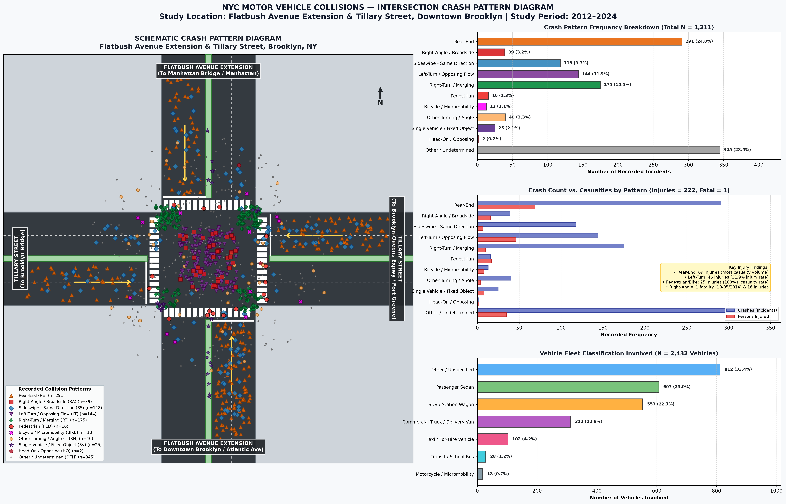

# Preparation of Crash Pattern Diagrams at Selected Urban Intersections
### Safety Engineering Coursework — Project 2

[](https://www.python.org/downloads/)
[](https://opensource.org/licenses/MIT)
[]()

This repository contains the end-to-end data processing, safety engineering classification, collision diagramming, and empirical reporting for **Project 2: Preparation of Crash Pattern Diagrams at Selected Urban Intersections**.

---

## 📍 Study Location & Empirical Sample

- **Intersection:** Flatbush Avenue Extension & Tillary Street, Downtown Brooklyn, New York City (`40.6960° N, 73.9845° W`).
- **Corridor Context:** Southern approach of the Manhattan Bridge (Flatbush Ave Ext) intersecting the major gateway to the Brooklyn Bridge and Brooklyn-Queens Expressway (I-278) (Tillary St).
- **Vision Zero Designation:** NYC DOT Priority Intersection.
- **Study Period:** July 3, 2012 – October 23, 2024 (**12.3 Years**).
- **Data Volume:** **1,211 recorded collisions** linked to **2,432 vehicle records** from the official NYPD Motor Vehicle Collisions database.

---

## 📊 Summary of Empirical Findings

| Collision Pattern | Crashes ($N$) | Proportion (%) | Injuries | Fatalities | Injury Severity Rate |
| :--- | :---: | :---: | :---: | :---: | :---: |
| **Rear-End Collision** | 291 | 24.03% | 69 | 0 | 23.71% |
| **Right-Turn / Merging Conflict** | 175 | 14.45% | 10 | 0 | 5.71% |
| **Left-Turn / Opposing-Flow Conflict** | 144 | 11.89% | 46 | 0 | **31.94%** |
| **Sideswipe (Same Direction)** | 118 | 9.74% | 7 | 0 | 5.93% |
| **Turning / Angle Conflict** | 40 | 3.30% | 4 | 0 | 10.00% |
| **Right-Angle (Broadside) Collision** | 39 | 3.22% | 16 | **1** | **41.03%** |
| **Single Vehicle / Fixed Object** | 25 | 2.06% | 8 | 0 | 32.00% |
| **Pedestrian Collision** | 16 | 1.32% | 17 | 0 | **106.25%** |
| **Bicycle / Micromobility Collision** | 13 | 1.07% | 8 | 0 | **61.54%** |
| **Head-On / Opposing Collision** | 2 | 0.17% | 2 | 0 | 100.00% |
| **Other / Undetermined (Predominantly PDO)** | 348 | 28.74% | 35 | 0 | 10.06% |
| **Total** | **1,211** | **100.00%** | **222** | **1** | **18.33%** |

---

## 🖼️ Schematic Crash Pattern Diagram

The scaled schematic collision diagram maps recorded collisions to geometric conflict zones according to FHWA / AASHTO Highway Safety Manual standards:



---

## 📁 Repository Structure

```
├── data/
│   ├── intersection_crashes.csv     # Processed crash subset (N = 1,211)
│   └── intersection_vehicles.csv    # Processed vehicle subset (N = 2,432)
├── scripts/
│   ├── process_crashes.py          # Data ingestion, schema standardization, and classification
│   ├── generate_diagram.py         # True-scale schematic layout & 300 DPI diagram rendering
│   ├── generate_presentation.py    # Automated PowerPoint deck creation
│   └── generate_docx.py            # Automated Word document creation
├── outputs/
│   ├── crash_pattern_diagram.png   # 300 DPI master collision diagram (6771 x 4352 px)
│   ├── supplementary_analysis.png  # Longitudinal trends, diurnal hourly curves, factors
│   └── summary_stats.csv           # Detailed aggregated metrics table
├── Project_2_Report.md             # Comprehensive academic technical report (Markdown)
├── Project_2_Report.docx           # Formatted report (Microsoft Word)
├── Project_2_Presentation.pptx     # Executive slide deck (Microsoft PowerPoint)
├── .gitignore                      # Git configuration (excludes large raw datasets)
└── README.md                       # Project documentation
```

---

## 🚀 Execution Instructions

### 1. Environment Setup
```bash
python -m venv .venv
# Windows:
.\.venv\Scripts\activate
# Linux/macOS:
source .venv/bin/activate

pip install pandas numpy matplotlib seaborn pillow python-pptx python-docx
```

### 2. Run Data Processing
```bash
python scripts/process_crashes.py
```

### 3. Generate Visual Diagrams & Dashboards
```bash
python scripts/generate_diagram.py
```

---

## 🎯 Key Recommendations for Flatbush Ave Ext & Tillary St
1. **Protected Left-Turn Phasing:** Eliminate permissive turns across 3 opposing lanes to address the 144 left-turn crashes and 46 injuries.
2. **Leading Pedestrian Intervals (LPI):** 7–10 second head start to mitigate turning vehicle conflicts against vulnerable road users.
3. **Advance Queue Detection & Warning:** Overhead DMS on the Manhattan Bridge approach to curb 291 rear-end collisions.
4. **Physical Channelization:** 150 ft upstream raised dividers to suppress abrupt weaving and sideswipes (118 crashes).
5. **Automated Enforcement:** Continuous red-light cameras to prevent high-speed broadside fatalities.

---

## 👤 Author
**Rishabh Prajapat**  
Coursework: Safety Engineering — Project 2  
